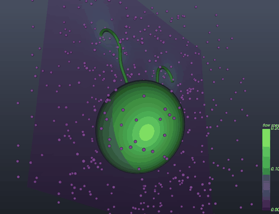

# Fluidlets

Regularized Stokeslets in Python, for flows at very small scales, where viscosity wins: cilia, glycocalyx brushes, swimming cells. The code is meant to be read and taught from, in the spirit of IB2d: IB2d-style input files, output you can open in ParaView, and worked examples that reproduce published results.



## What it does now

- **3D regularized Stokeslets** (Cortez, Fauci & Medovikov 2005), with the **exact image system for a no-slip wall** (Ainley et al. 2008).
- **Resistance problems:** you set the velocity on a structure, and Fluidlets solves for the forces, using dense LU or matrix-free GMRES.
- **Free swimming:** a cell that moves by changing its shape, with zero net force and torque, using the nearest-neighbour discretization of Gallagher & Smith (2018).
- **Fast, parallel kernel sums** with Numba, for real or complex viscosity.
- **Input and output:** `input2d`/`input3d` parameter files and `.vertex` geometry as in IB2d; VTK files (`.vtp`, `.vtr`, `.pvd`) for ParaView and VisIt.

## Examples

Each folder in `examples/` runs with `python run.py` and explains the physics in its README.

| Example | What it shows | Checked against |
|---|---|---|
| `glycocalyx_towers` | protein towers held fixed in shear flow above a wall | the original 2010 UNC code, to 10⁻⁷ |
| `translating_sphere` | drag and torque on a sphere | Cortez, Fauci & Medovikov (2005), Table II |
| `sphere_near_wall` | how a wall raises the drag on a sphere | Ainley et al. (2008), Tables 1–2 |
| `biflagellate_swimmer` | a model alga swimming with two flagella, with movies | Gallagher & Smith (2018), Table II |

Tutorial notebooks are in `tutorials/`.

## Install

Fluidlets needs Python 3.10 or later, NumPy, SciPy and Numba.

```bash
git clone https://github.com/fairyflies9/fluidlets.git
cd fluidlets
pip install -e .
python -m pytest
```

```python
import numpy as np
import fluidlets as fl

sources = np.array([[0.0, 0.0, 1.0]])                    # a point force 1 unit above a wall
forces = np.array([[1.0, 0.0, 0.0]])
targets = np.array([[0.5, 0.0, 0.5], [0.5, 0.0, 0.0]])   # the second point is on the wall
u = fl.evaluate(fl.WallStokeslet3D(), targets, sources, forces, eps=0.05)
print(u)                                                 # the velocity on the wall is zero
```

## Coming next

The plan is in `DESIGN.md`: 2D Stokeslets and Brinkmanlets (porous media), Oseenlets (a little inertia), electrostatics coupled to flow (charged pollen landing on flowers), vortex sheets for flapping and flexible plates, viscoelastic and shear-thinning fluids, and more tutorials and course modules.

## Where it came from

Fluidlets was the software goal of the NSF Focused Research Group *Advanced Algorithms and Software for Problems in Computational Bio-Fluid Dynamics* (DMS-0854961, 2009–2013) at UNC Chapel Hill, with Michael Minion, Jan Prins, Jingfang Huang, and Laura Miller. It starts from the regularized Stokeslet code written for the group's glycocalyx project. That code is kept unchanged in `legacy/`, and `docs/legacy_verification.md` records how the new code was checked against it.

Developed by Laura A. Miller and collaborators. BSD 3-Clause License.
